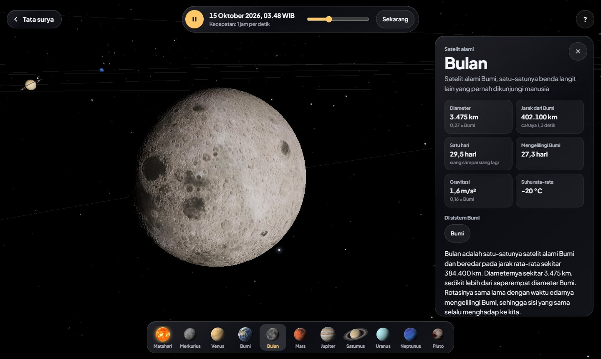
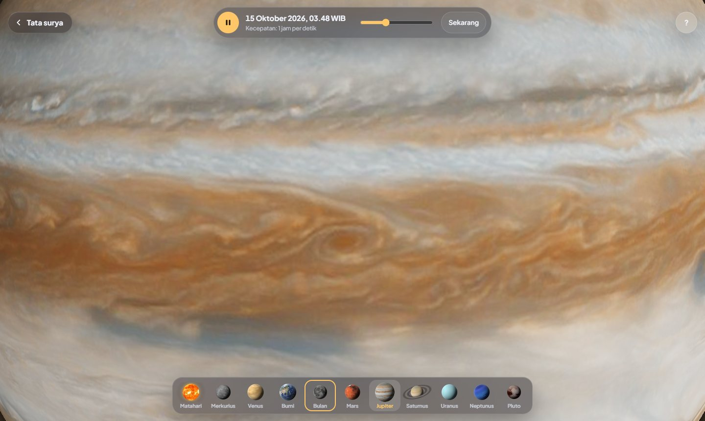

# Interactive Solar System (Education)

Tata surya 3D interaktif berbahasa Indonesia. Planet dan 21 satelitnya tampil dengan peta permukaan dari data wahana antariksa, berada di posisi sebenarnya untuk tanggal yang tampil, dan bisa didekati, diputar, serta diperbesar langsung di browser.

<p align="center">
  <a href="https://eedtan.github.io/Interactive-Solar-System-Education/">
    
  </a>
</p>

<p align="center">
  <a href="https://eedtan.github.io/Interactive-Solar-System-Education/">
    
  </a>
</p>

<p align="center">
  
  
</p>

<p align="center">
  
  
</p>

## Cara memakai

- Pilih benda dari deretan gambar di bawah layar, klik planetnya langsung, atau klik namanya. Kamera terbang ke sana dengan mulus, termasuk saat kamu memilih benda lain sebelum kamera sampai.
- Seret untuk memutar arah kamera. Gulir atau cubit untuk memperbesar. Menggulir di atas planet atau satelit mana pun membawa kamera mendekatinya tanpa harus memilihnya dulu, dan teksturnya berganti ke resolusi tinggi saat benda itu cukup besar di layar.
- Kartu info sebuah planet punya tombol ke satelit-satelitnya, misalnya Io, Europa, Ganymede, dan Callisto untuk Jupiter.
- Tekan Esc atau tombol di kiri atas untuk kembali melihat seluruh tata surya.
- Bilah di atas menjeda atau menjalankan waktu, mengatur kecepatannya dari waktu nyata sampai 1 tahun per detik, dan mengembalikan ke saat sekarang.
- Dengan papan ketik: panah kiri dan kanan berpindah benda, panah atas dan bawah memutar kamera naik turun, Shift dengan panah kiri atau kanan memutar ke samping, tombol + dan - memperbesar atau memperkecil, dan Spasi menjeda waktu.

## Yang bisa dipelajari

- Letak tiap planet hari ini, dihitung dari elemen orbit JPL, dan gerakannya: planet dalam beredar jauh lebih cepat daripada planet luar, dan orbit Pluto lonjong serta miring.
- Rupa tiap benda dari dekat: awan, kilau laut, dan lampu kota Bumi; kawah Bulan dan Merkurius; Valles Marineris di Mars; pita awan Jupiter; wilayah kemerahan dan dataran es di Pluto.
- Cincin Saturnus dari peta 8K: celah Cassini, celah Encke, dan cincin C yang tipis. Bayangan cincin jatuh di permukaan Saturnus dan bayangan Saturnus jatuh di cincin. Saturnus melewati ekuinoks pada Mei 2025, jadi selama beberapa tahun ini Matahari menyinari cincin dari sudut sangat rendah: cincin tampak lebih redup dan bayangan planetnya memanjang. Cincin Uranus yang tipis dan gelap juga digambar dari data jari-jarinya.
- 21 satelit dengan peta permukaan asli: Bulan, Phobos dan Deimos, empat satelit Galileo, tujuh satelit besar Saturnus, lima satelit besar Uranus, Triton, dan Charon. Letaknya dihitung dari elemen orbit JPL, semuanya terkunci pasang surut (selalu menghadapkan sisi yang sama ke planetnya), dan Triton beredar berlawanan arah. Kecerahannya mengikuti albedo NASA: Phobos segelap arang, Enceladus seputih salju, Iapetus punya satu belahan gelap dan satu belahan terang, dan Titan tertutup kabut jingga.
- Kemiringan sumbu dan arah putaran menurut data IAU: Uranus tampak terguling, Venus dan Uranus berputar terbalik, dan sisi siang serta malam Bumi sesuai jam yang tampil.
- Kartu info tiap benda: diameter, jarak dari Bumi saat itu beserta waktu tempuh cahayanya, panjang hari dan tahun, gravitasi, suhu, jumlah satelit, serta penjelasan dan fakta dalam bahasa Indonesia.

Ukuran planet dan satelit sebanding satu sama lain. Matahari diperkecil, dan jarak antarplanet serta jarak satelit ke planetnya dipadatkan supaya semuanya muat di layar.

## Bahasa pemrograman

| Bahasa | Dipakai untuk |
|---|---|
| HTML | Satu halaman: kanvas 3D, label, kartu info, bilah waktu, deretan benda, panduan |
| CSS | Tampilan kaca buram (blur) di atas adegan 3D, termasuk tata letak khusus tablet dan ponsel |
| JavaScript | Adegan 3D dengan [three.js](https://threejs.org/) (WebGL), posisi planet dan satelit, rotasi tiap benda, kamera, dan interaksi |
| Python | Menyusun dan memeriksa data menjadi `js/data.js` (`tools/build_data.py`), dan merender gambar planet untuk deretan benda (`tools/make_thumbs.py`) |

```
Interactive-Solar-System-Education/
├── index.html            satu-satunya halaman
├── css/app.css           tampilan kaca
├── js/
│   ├── app.js            kamera, zoom, waktu, label, deretan benda, kartu info
│   ├── planets.js        benda langit 3D: tekstur, atmosfer, awan, cincin, satelit, cahaya Matahari
│   ├── astro.js          perhitungan posisi planet dan Bulan
│   ├── data.js           dibuat otomatis dari folder data/
│   └── vendor/three/     three.js
├── assets/
│   ├── textures/         peta permukaan planet 1K, 2K, 4K, cincin Saturnus 4K dan 8K
│   │   └── moons/        peta 20 satelit 1K dan 2K
│   ├── thumbs.webp       gambar planet untuk deretan benda
│   └── fonts/            Plus Jakarta Sans
├── data/                 sumber data CSV dan JSON (penjelasan di data/README.md)
├── tools/
│   ├── build_data.py     penyusun dan pemeriksa data
│   └── make_thumbs.py    perender gambar deretan benda
├── tests/                uji perhitungan dengan data rujukan JPL Horizons
└── docs/                 gambar untuk README
```

Tekstur 1K dimuat lebih dulu supaya halaman cepat terbuka. Tekstur 2K atau 4K baru dimuat saat sebuah benda tampak cukup besar di layar, baik karena dipilih maupun karena didekati dengan zoom, dan dimuat setelah kamera berhenti supaya perjalanannya tidak tersendat. Bila komputer terlalu lambat untuk 40 bingkai per detik, resolusi gambar diturunkan sedikit demi sedikit.

## Menjalankan di komputer sendiri

Browser tidak mengizinkan tampilan 3D bertekstur dari berkas yang dibuka langsung dari disk, jadi jalankan server lokal di folder proyek:

```
python -m http.server 8000
```

lalu buka `http://localhost:8000`.

Kalau mengubah isi folder `data/`, jalankan `python tools/build_data.py`. Kalau mengganti tekstur planet, jalankan `python tools/make_thumbs.py` (butuh numpy dan Pillow). Uji perhitungan astronomi (butuh Node.js): `node tests/test_astro.js`.

Kalau tampilan 3D terasa berat, pastikan akselerasi perangkat keras (hardware acceleration) aktif di pengaturan browser.

## Sumber data dan kredit

- Posisi planet: [JPL Approximate Positions of the Planets](https://ssd.jpl.nasa.gov/planets/approx_pos.html), berlaku tahun 1800 sampai 2050. Selisihnya dengan JPL Horizons paling besar sekitar 0,2 derajat.
- Posisi satelit: [JPL Planetary Satellite Mean Elements](https://ssd.jpl.nasa.gov/sats/elem/) (epoch 1 Januari 2000), dengan orbit dianggap lingkaran, jadi letaknya bisa meleset sampai sekitar 3 derajat.
- Data fisik: [NASA NSSDCA Planetary Fact Sheet](https://nssdc.gsfc.nasa.gov/planetary/factsheet/) dan fact sheet tiap planet dan satelitnya. Satelit: [JPL Planetary Satellites](https://ssd.jpl.nasa.gov/sats/), jumlahnya dicek per 14 Oktober 2026.
- Arah sumbu dan rotasi: IAU WGCCRE (Archinal dkk., 2018). Posisi Bulan: Jean Meeus, *Astronomical Algorithms*.
- Tekstur planet dan cincin Saturnus: [Solar System Scope](https://www.solarsystemscope.com/textures/) (CC BY 4.0) dan peta Pluto NASA/JHUAPL/SwRI. Peta satelit: mosaik Galileo, Cassini, Voyager, Viking, dan New Horizons dari USGS Astrogeology dan NASA/JPL, kecerahannya disesuaikan dengan albedo NASA NSSDCA. Rincian di [assets/CREDITS.md](assets/CREDITS.md).
- Huruf Plus Jakarta Sans (Tokotype, SIL Open Font License) dan three.js (lisensi MIT).

Rincian kolom, satuan, dan keputusan data ada di [data/README.md](data/README.md).

## Lisensi

Kode di repositori ini memakai [lisensi MIT](LICENSE). Tekstur dan huruf memakai lisensinya masing-masing seperti tercantum di atas.
