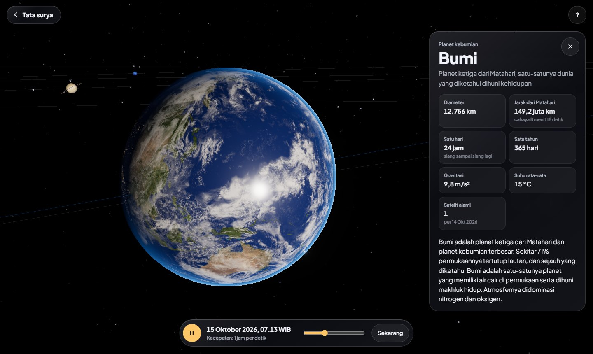
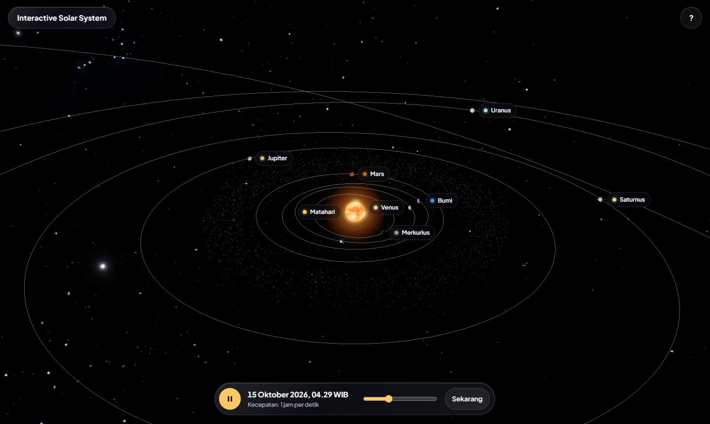
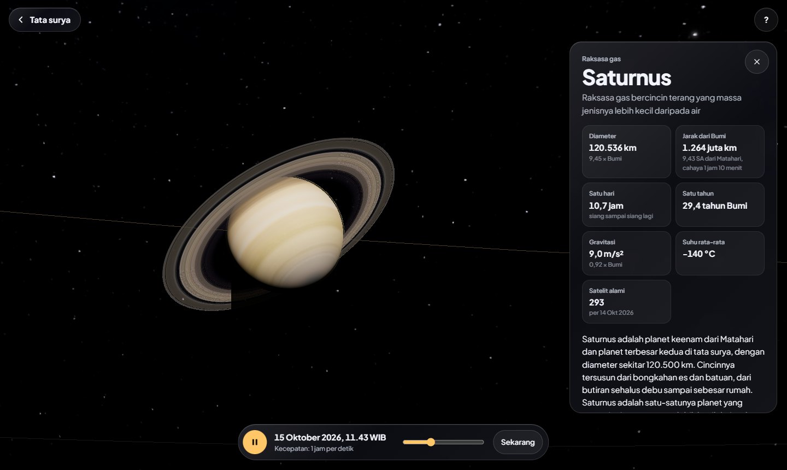

# Interactive Solar System (Education)

Tata surya 3D interaktif berbahasa Indonesia. Planet tampil dengan tekstur dari data wahana antariksa, berada di posisi sebenarnya untuk tanggal yang tampil, dan bisa didekati, diputar, serta diperbesar langsung di browser.

<p align="center">
  <a href="https://eedtan.github.io/Interactive-Solar-System-Education/">
    
  </a>
</p>

<p align="center">
  <a href="https://eedtan.github.io/Interactive-Solar-System-Education/">
    
  </a>
</p>

<p align="center">
  
  
</p>

## Cara memakai

- Klik atau ketuk sebuah planet, atau namanya, dan kamera akan terbang mendekat.
- Seret untuk memutar arah kamera. Gulir atau cubit untuk memperbesar sampai detail permukaannya terlihat.
- Tekan Esc atau tombol di kiri atas untuk kembali melihat seluruh tata surya.
- Bilah di bawah menjeda atau menjalankan waktu, mengatur kecepatannya dari waktu nyata sampai 1 tahun per detik, dan mengembalikan ke saat sekarang.
- Dengan papan ketik: panah kiri dan kanan berpindah benda, panah atas dan bawah memutar kamera naik turun, Shift dengan panah kiri atau kanan memutar ke samping, tombol + dan - memperbesar atau memperkecil, dan Spasi menjeda waktu.

## Yang bisa dipelajari

- Letak tiap planet hari ini, dihitung dari elemen orbit JPL, dan gerakannya: planet dalam beredar jauh lebih cepat daripada planet luar, dan orbit Pluto lonjong serta miring.
- Rupa tiap benda dari dekat: awan, kilau laut, dan lampu kota Bumi; kawah Bulan dan Merkurius; Valles Marineris di Mars; pita awan Jupiter; cincin Saturnus beserta bayangan planetnya; wilayah kemerahan dan dataran es di Pluto.
- Kemiringan sumbu dan arah putaran menurut data IAU: Uranus tampak terguling, Venus dan Uranus berputar terbalik, dan sisi siang serta malam Bumi sesuai jam yang tampil.
- Kartu info tiap benda: diameter, jarak dari Bumi saat itu beserta waktu tempuh cahayanya, panjang hari dan tahun, gravitasi, suhu, jumlah satelit, serta penjelasan dan fakta dalam bahasa Indonesia.

Ukuran planet sebanding satu sama lain. Matahari diperkecil, dan jarak antarplanet serta jarak Bulan dipadatkan supaya semuanya muat di layar.

## Bahasa pemrograman

| Bahasa | Dipakai untuk |
|---|---|
| HTML | Satu halaman: kanvas 3D, label, kartu info, bilah waktu, panduan |
| CSS | Tampilan kaca buram (blur) di atas adegan 3D, termasuk tata letak khusus ponsel |
| JavaScript | Adegan 3D dengan [three.js](https://threejs.org/) (WebGL), posisi planet dan Bulan, rotasi tiap benda, kamera, dan interaksi |
| Python | Menyusun dan memeriksa data menjadi `js/data.js` (`tools/build_data.py`) |

```
Interactive-Solar-System-Education/
├── index.html            satu-satunya halaman
├── css/app.css           tampilan kaca
├── js/
│   ├── app.js            kamera, waktu, label, kartu info
│   ├── planets.js        benda langit 3D: tekstur, atmosfer, awan, cincin, cahaya Matahari
│   ├── astro.js          perhitungan posisi planet dan Bulan
│   ├── data.js           dibuat otomatis dari folder data/
│   └── vendor/three/     three.js
├── assets/
│   ├── textures/         peta permukaan planet 1K, 2K, 4K
│   └── fonts/            Plus Jakarta Sans
├── data/                 sumber data CSV dan JSON (penjelasan di data/README.md)
├── tools/build_data.py   penyusun dan pemeriksa data (Python)
├── tests/                uji perhitungan dengan data rujukan JPL Horizons
└── docs/                 gambar untuk README
```

Tekstur 1K dimuat lebih dulu supaya halaman cepat terbuka. Tekstur 2K atau 4K baru dimuat saat sebuah benda didekati.

## Menjalankan di komputer sendiri

Browser tidak mengizinkan tampilan 3D bertekstur dari berkas yang dibuka langsung dari disk, jadi jalankan server lokal di folder proyek:

```
python -m http.server 8000
```

lalu buka `http://localhost:8000`.

Kalau mengubah isi folder `data/`, jalankan `python tools/build_data.py`. Uji perhitungan astronomi (butuh Node.js): `node tests/test_astro.js`.

Kalau tampilan 3D terasa berat, pastikan akselerasi perangkat keras (hardware acceleration) aktif di pengaturan browser.

## Sumber data dan kredit

- Posisi planet: [JPL Approximate Positions of the Planets](https://ssd.jpl.nasa.gov/planets/approx_pos.html), berlaku tahun 1800 sampai 2050. Selisihnya dengan JPL Horizons paling besar sekitar 0,2 derajat.
- Data fisik: [NASA NSSDCA Planetary Fact Sheet](https://nssdc.gsfc.nasa.gov/planetary/factsheet/) dan fact sheet tiap planet. Satelit: [JPL Planetary Satellites](https://ssd.jpl.nasa.gov/sats/), jumlahnya dicek per 14 Oktober 2026.
- Arah sumbu dan rotasi: IAU WGCCRE (Archinal dkk., 2018). Posisi Bulan: Jean Meeus, *Astronomical Algorithms*.
- Tekstur: [Solar System Scope](https://www.solarsystemscope.com/textures/) (CC BY 4.0) dan peta Pluto NASA/JHUAPL/SwRI. Rincian di [assets/CREDITS.md](assets/CREDITS.md).
- Huruf Plus Jakarta Sans (Tokotype, SIL Open Font License) dan three.js (lisensi MIT).

Rincian kolom, satuan, dan keputusan data ada di [data/README.md](data/README.md).

## Lisensi

Kode di repositori ini memakai [lisensi MIT](LICENSE). Tekstur dan huruf memakai lisensinya masing-masing seperti tercantum di atas.
