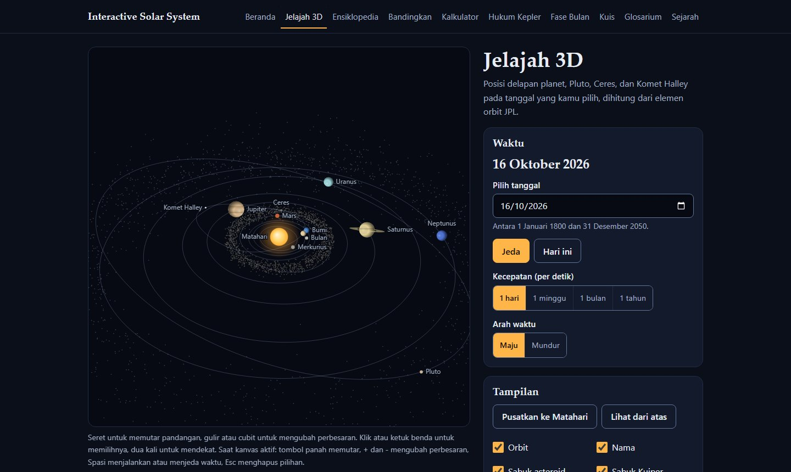

# Interactive Solar System (Education)

Media belajar tata surya berbahasa Indonesia yang berjalan langsung di browser. Posisi planet dihitung untuk tanggal yang kamu pilih, dan angka-angkanya berasal dari NASA dan JPL.

<p align="center">
  <a href="https://eedtan.github.io/Interactive-Solar-System-Education/">
    
  </a>
</p>

<p align="center">
  <a href="https://eedtan.github.io/Interactive-Solar-System-Education/jelajah.html">
    
  </a>
</p>

<p align="center">
  Buka langsung:
  <a href="https://eedtan.github.io/Interactive-Solar-System-Education/">Beranda</a> ·
  <a href="https://eedtan.github.io/Interactive-Solar-System-Education/jelajah.html">Jelajah 3D</a> ·
  <a href="https://eedtan.github.io/Interactive-Solar-System-Education/ensiklopedia.html">Ensiklopedia</a> ·
  <a href="https://eedtan.github.io/Interactive-Solar-System-Education/bandingkan.html">Bandingkan</a> ·
  <a href="https://eedtan.github.io/Interactive-Solar-System-Education/kalkulator.html">Kalkulator</a> ·
  <a href="https://eedtan.github.io/Interactive-Solar-System-Education/kepler.html">Hukum Kepler</a> ·
  <a href="https://eedtan.github.io/Interactive-Solar-System-Education/bulan.html">Fase Bulan</a> ·
  <a href="https://eedtan.github.io/Interactive-Solar-System-Education/kuis.html">Kuis</a> ·
  <a href="https://eedtan.github.io/Interactive-Solar-System-Education/glosarium.html">Glosarium</a> ·
  <a href="https://eedtan.github.io/Interactive-Solar-System-Education/sejarah.html">Sejarah</a>
</p>

## Yang bisa dipelajari

| Halaman | Yang bisa kamu lakukan | Materi |
|---|---|---|
| [Beranda](https://eedtan.github.io/Interactive-Solar-System-Education/) | Melihat letak delapan planet hari ini beserta jaraknya dari Matahari | Susunan tata surya, satuan astronomi |
| [Jelajah 3D](https://eedtan.github.io/Interactive-Solar-System-Education/jelajah.html) | Memutar dan memperbesar model tiga dimensi, memilih tanggal antara tahun 1800 dan 2050, mempercepat atau memundurkan waktu, lalu memilih benda untuk melihat datanya. Ada juga tabel jarak tiap planet dari Bumi dan perkiraan kapan planet itu paling mudah diamati. | Revolusi planet, orbit yang lonjong dan miring (Pluto, Komet Halley), skala jarak, ekor komet yang selalu menjauhi Matahari |
| [Ensiklopedia](https://eedtan.github.io/Interactive-Solar-System-Education/ensiklopedia.html) | Membaca profil 16 benda langit dan 4 wilayah tata surya: foto NASA, data fisik dan orbit, fakta, satelit utama, dan misi antariksa | Planet kebumian, raksasa gas, raksasa es, planet kerdil, satelit, komet, sabuk asteroid, Sabuk Kuiper, Awan Oort, heliosfer |
| [Bandingkan](https://eedtan.github.io/Interactive-Solar-System-Education/bandingkan.html) | Menjajarkan planet sesuai ukuran sebenarnya, membandingkan dua benda, membuat grafik dari sepuluh besaran (ada pilihan skala logaritmik), dan mengurutkan tabel data | Perbandingan ukuran, massa, gravitasi, jarak, dan suhu; membaca grafik |
| [Kalkulator](https://eedtan.github.io/Interactive-Solar-System-Education/kalkulator.html) | Menghitung berat badan di benda lain, umur dalam tahun planet lain, waktu tempuh cahaya, model skala tata surya, dan lama perjalanan ke tiap planet | Massa dan berat, periode revolusi, kecepatan cahaya, skala jarak |
| [Hukum Kepler](https://eedtan.github.io/Interactive-Solar-System-Education/kepler.html) | Mengubah kelonjongan orbit, lalu mengamati planet yang melaju lebih cepat di dekat Matahari, tali dua titik fokus, dan juring yang luasnya sama; menghitung periode orbit dari jarak | Hukum Kepler I, II, dan III |
| [Fase Bulan](https://eedtan.github.io/Interactive-Solar-System-Education/bulan.html) | Melihat bentuk Bulan pada tanggal dan jam pilihanmu, menggeser umur Bulan sepanjang satu siklus, melihat jadwal fase berikutnya dan kalender fase | Penyebab fase Bulan, bulan sinodis dan sideris, rotasi sinkron, hilal |
| [Kuis](https://eedtan.github.io/Interactive-Solar-System-Education/kuis.html) | Mengerjakan soal pilihan ganda dari bank 60 soal dalam 5 topik, dengan pembahasan di setiap jawaban | Evaluasi semua materi |
| [Glosarium](https://eedtan.github.io/Interactive-Solar-System-Education/glosarium.html) | Mencari arti 54 istilah astronomi dan mengikuti tautan ke istilah yang berkaitan | Istilah dasar tata surya |
| [Sejarah](https://eedtan.github.io/Interactive-Solar-System-Education/sejarah.html) | Menelusuri 36 peristiwa, dari catatan Komet Halley tahun 240 SM sampai misi tahun 2026, termasuk tonggak di Indonesia | Sejarah astronomi dan penjelajahan antariksa |

## Cara memakai

Untuk belajar sendiri, urutan ini bisa diikuti:

1. Jelajah 3D: lihat susunan tata surya, jalankan waktu, dan perhatikan planet dalam beredar jauh lebih cepat daripada planet luar.
2. Ensiklopedia: baca profil Matahari dan Bumi, lalu satu planet yang paling membuatmu penasaran.
3. Bandingkan: lihat ukuran sebenarnya dan bandingkan planet pilihanmu dengan Bumi.
4. Hukum Kepler: amati orbit yang berbentuk elips dan planet yang melaju lebih cepat saat dekat Matahari.
5. Fase Bulan: cocokkan bentuk Bulan dengan posisinya terhadap Matahari dan Bumi.
6. Kalkulator: pakai angka yang sudah kamu baca untuk berlatih menghitung.
7. Kuis: kerjakan per topik dan baca pembahasan untuk jawaban yang salah.

Glosarium bisa dibuka kapan saja saat bertemu istilah asing.

Untuk guru, Jelajah 3D cocok ditampilkan lewat proyektor: hentikan waktu, minta siswa menebak letak planet sebulan kemudian, lalu jalankan lagi untuk memeriksa. Kuis bisa dipilih per topik untuk mengecek pemahaman di akhir satu pokok bahasan; skornya hanya tersimpan di browser siswa. Kalkulator bisa dipakai untuk memeriksa soal hitungan yang dikerjakan di kertas.

## Bahasa pemrograman

| Bahasa | Dipakai untuk |
|---|---|
| HTML | Struktur 10 halaman |
| CSS | Tampilan: satu sistem desain bersama (`css/style.css`) ditambah aturan khusus tiap halaman |
| JavaScript | Semua interaksi dan perhitungan di browser: posisi planet dari elemen orbit Kepler, fase Bulan, gambar 3D di kanvas (dibuat sendiri tanpa pustaka), grafik, kalkulator, dan kuis |
| Python | Menyusun dan memeriksa data (`tools/build_data.py` mengubah CSV dan JSON menjadi `js/data.js`) serta mengambil elemen orbit dari JPL Horizons (`tools/fetch_small_bodies.py`) |

Tidak ada framework atau pustaka luar, jadi setiap baris kodenya bisa dibaca dan dipelajari.

```
Interactive-Solar-System-Education/
├── index.html, jelajah.html, ...   10 halaman
├── css/
│   ├── style.css                   sistem desain bersama
│   └── <halaman>.css               aturan khusus tiap halaman
├── js/
│   ├── astro.js                    perhitungan astronomi (posisi planet, fase Bulan)
│   ├── common.js                   fungsi bersama (format angka, gambar planet, penggaris jarak, menu)
│   ├── orrery.js                   mesin gambar 3D untuk Jelajah 3D
│   ├── data.js                     dibuat otomatis dari folder data/
│   └── <halaman>.js                logika tiap halaman
├── data/                           sumber data: CSV dan JSON (penjelasan di data/README.md)
├── img/                            foto NASA tiap benda langit
├── tools/                          skrip Python
├── tests/                          uji perhitungan dan data rujukan JPL Horizons serta USNO
└── docs/                           gambar untuk README
```

## Menjalankan di komputer sendiri

Situs ini tidak butuh server atau internet.

1. Di halaman GitHub ini, klik tombol Code lalu Download ZIP (atau pakai `git clone`), kemudian ekstrak.
2. Buka `index.html` di browser.

Kalau ingin mengubah data, edit berkas di folder `data/`, lalu jalankan:

```
python tools/build_data.py
```

Skrip itu memeriksa data dulu (kolom, angka, rujukan antarberkas, kecocokan dengan rumus fisika) sebelum menulis `js/data.js`.

Uji perhitungan astronomi (butuh Node.js):

```
node tests/test_astro.js
```

Uji ini membandingkan posisi planet dengan JPL Horizons dan saat fase Bulan dengan tabel USNO.

## Sumber data dan ketelitian

- Data fisik: [NASA NSSDCA Planetary Fact Sheet](https://nssdc.gsfc.nasa.gov/planetary/factsheet/) dan fact sheet tiap benda.
- Posisi planet: [JPL Approximate Positions of the Planets](https://ssd.jpl.nasa.gov/planets/approx_pos.html), berlaku tahun 1800 sampai 2050. Selisihnya dengan JPL Horizons paling besar sekitar 0,2 derajat (Saturnus).
- Ceres dan Komet Halley: beberapa set elemen orbit dari [JPL Horizons](https://ssd.jpl.nasa.gov/horizons/).
- Satelit: [JPL Planetary Satellites](https://ssd.jpl.nasa.gov/sats/) dan [NASA Science](https://science.nasa.gov/solar-system/moons/). Jumlah satelit dicek per 14 Oktober 2026.
- Fase Bulan: rumus Jean Meeus, *Astronomical Algorithms*. Selisihnya dengan tabel USNO 2026 paling besar 9 menit.

Rincian tiap kolom, satuan, dan keputusan data ada di [data/README.md](data/README.md).

## Kredit foto

| Benda | Kredit | Sumber |
|---|---|---|
| Matahari | Courtesy of NASA/SDO and the AIA, EVE, and HMI science teams | [images.nasa.gov](https://images.nasa.gov/details/GSFC_20171208_Archive_e000923) |
| Merkurius | NASA/Johns Hopkins University Applied Physics Laboratory/Arizona State University/Carnegie Institution of Washington | [science.nasa.gov](https://science.nasa.gov/photojournal/mercurys-true-color-is-in-the-eye-of-the-beholder/) |
| Venus | NASA/JPL-Caltech | [science.nasa.gov](https://science.nasa.gov/photojournal/venus-from-mariner-10/) |
| Bumi | NASA Johnson Space Center | [science.nasa.gov](https://science.nasa.gov/resource/the-blue-marble/) |
| Bulan | NASA | [images.nasa.gov](https://images.nasa.gov/details/art002e009057) |
| Mars | NASA/JPL/USGS | [science.nasa.gov](https://science.nasa.gov/photojournal/global-color-views-of-mars/) |
| Ceres | NASA/JPL-Caltech/UCLA/MPS/DLR/IDA | [science.nasa.gov](https://science.nasa.gov/photojournal/ceres-in-color/) |
| Jupiter | NASA/ESA | [images.nasa.gov](https://images.nasa.gov/details/GSFC_20171208_Archive_e001094) |
| Saturnus | NASA/JPL/Space Science Institute | [science.nasa.gov](https://science.nasa.gov/photojournal/saturn-four-years-on/) |
| Uranus | NASA/JPL-Caltech | [science.nasa.gov](https://science.nasa.gov/photojournal/uranus-as-seen-by-nasas-voyager-2/) |
| Neptunus | NASA/JPL | [science.nasa.gov](https://science.nasa.gov/photojournal/neptune-full-disk-view/) |
| Pluto | NASA/Johns Hopkins University Applied Physics Laboratory/Southwest Research Institute | [science.nasa.gov](https://science.nasa.gov/photojournal/pluto-in-true-color/) |
| Komet Halley | W. Liller, International Halley Watch Large Scale Phenomena Network; NASA/NSSDCA | [nssdc.gsfc.nasa.gov](https://nssdc.gsfc.nasa.gov/photo_gallery/photogallery-comets.html#halley) |

Foto-foto ini dipakai untuk keperluan pendidikan sesuai pedoman penggunaan media NASA dan mitranya. Foto tidak termasuk dalam lisensi kode di bawah.

## Lisensi

Kode di repositori ini memakai [lisensi MIT](LICENSE).
